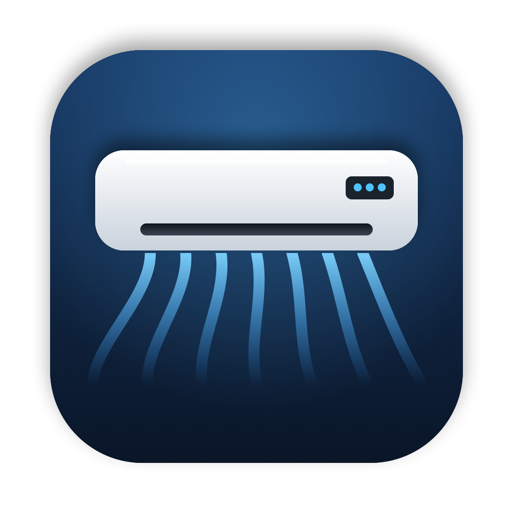
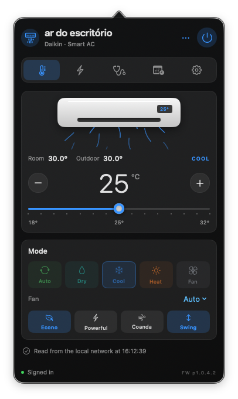
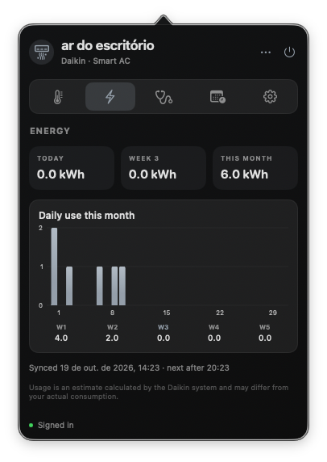
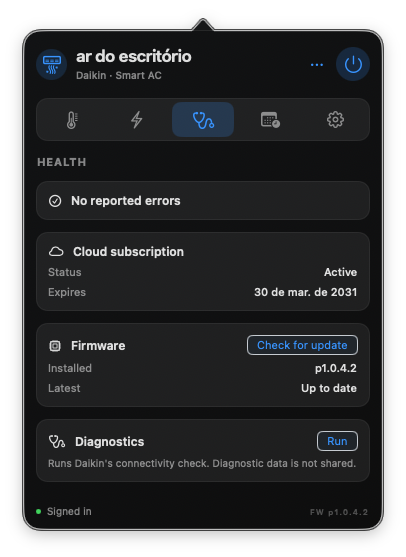
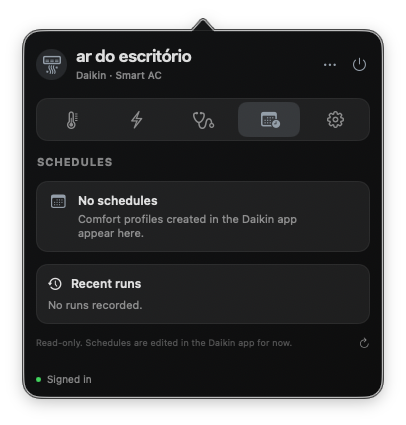

<p align="center"></p>

# DaikinAC-menubar

A native macOS menu bar app for **Daikin Smart AC (Brazil)** units — the ones set up with the
*Daikin Smart AC* mobile app. Control the AC, see its energy use, health and schedules, from the
menu bar, over your Wi-Fi or through the cloud.

> Unofficial. Not affiliated with, endorsed by or supported by Daikin or IOTA Labs. Use it only
> with your own account and your own devices.

## Screenshots

<p align="center">
  
  
  
  
</p>

## Features

- **Control** — power, mode (Auto, Dry, Cool, Heat, Fan), target temperature with a slider, fan speed,
  and the extras: Econo (energy saving), Powerful, Coanda and swing. The official app's rules apply
  (per-mode temperature ranges, Econo and Powerful exclude each other, and so on).
- **Local network first** — talks to the unit directly on your Wi-Fi (mDNS discovery, encrypted
  local API) and falls back to the cloud when the unit is not on the same network. Local control
  also works **without signing in**, with the Device Key from the Daikin app.
- **Cloud** — sign in with your Daikin Smart AC account (Cognito SRP); live state over the AWS IoT
  device shadow (MQTT on WebSocket).
- **Energy** — today, the current week and month, and a daily chart, from the unit's meter readings
  (synced at most every 6 hours).
- **Health** — reported error codes with their Daikin description, cloud subscription status and
  expiry warning, firmware version check (read only) and Daikin's diagnostics.
- **Schedules** — your comfort profiles and their run history (read only for now).

## Requirements

macOS 14 or later. Building needs the Swift 5.9+ toolchain (Xcode or the Command Line Tools).

## Install

1. Download `DaikinAC-menubar-<version>.zip` from the
   [Releases](../../releases) page and unzip it.
2. Move `DaikinAC-menubar.app` to `/Applications`.
3. The app is not notarized. On first launch, right-click it and choose **Open**, or run
   `xattr -dr com.apple.quarantine /Applications/DaikinAC-menubar.app`.
4. Click the air-conditioner icon in the menu bar → Settings, and either sign in with your Daikin
   Smart AC account or paste the Device Key (Daikin app → Menu → Integrations → Home Assistant).
   macOS asks once for local network access.

## Build from source

```sh
bash scripts/build.sh                                        # → dist/DaikinAC-menubar.app
dist/DaikinAC-menubar.app/Contents/MacOS/DaikinACMenubar --self-check
python3 scripts/privacy-check.py
bash scripts/package-release.sh                              # → dist/DaikinAC-menubar-<version>.zip
```

The only dependency is [attaswift/BigInt](https://github.com/attaswift/BigInt) (MIT), pinned in
`Package.resolved`, for the Cognito SRP math. `scripts/make-icon.sh` redraws the icon.

## Privacy and security

- Your password is never stored. The refresh token, the selected device and, for local control,
  the device key are kept in the macOS Keychain.
- No analytics. The app talks only to Daikin's backend (`dmb.iotalabs.co.in`), AWS Cognito, AWS IoT
  and your AC on the local network.
- It never calls onboarding, reset, firmware-upgrade or account-deletion endpoints. Diagnostics are
  run without sharing diagnostic data.
- The app records the *shape* of each API response, with every value masked, under
  `~/Library/Application Support/DaikinAC-menubar/shapes/`, to help check the API without exposing data.

## Credits

Inspired by [LGwebOS-menubar](https://github.com/gabrielgreco1/LGwebOS-menubar), a native macOS menu
bar remote for LG webOS TVs; its menu bar shell and design primitives are adapted here (MIT). The local
protocol was cross-checked against Daikin Brazil's open-source
[ha-custom-integration](https://github.com/daikin-br/ha-custom-integration) and
[pyiotdevice](https://github.com/daikin-br/pyiotdevice) (MIT). See
[THIRD_PARTY_NOTICES.md](THIRD_PARTY_NOTICES.md).

## License

[MIT](LICENSE)
